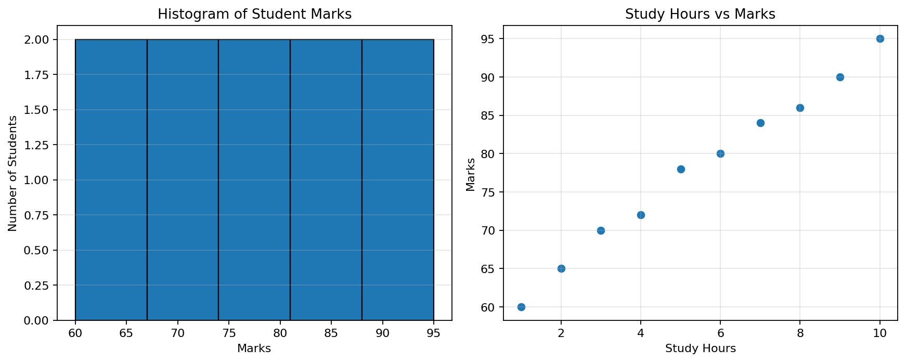

# 📊 DAV Lab: Histogram and Scatter Plot

## 🎯 Problem Statement
Write a Python program using **pandas** and **matplotlib** to:
1. Draw a histogram showing the distribution of student marks.
2. Draw a scatter plot showing the relationship between study hours and marks.

## 🧰 Requirements
Install the required libraries:
```bash
python -m pip install pandas matplotlib
```

## ▶️ How to Run
1. Keep `dav_histogram_scatter.py` and this `README.md` in the same folder.
2. Run:
   ```bash
   python dav_histogram_scatter.py
   ```
3. The program displays both graphs and saves `histogram.png` and `scatter_plot.png`.

## 🖥️ Expected Console Output
```text
DAV Lab: Histogram and Scatter Plot

Dataset:
 Study Hours  Marks
           1     60
           2     65
           3     70
           4     72
           5     78
           6     80
           7     84
           8     86
           9     90
          10     95

Output graphs saved as histogram.png and scatter_plot.png
```

## 📈 Program Output
The graphs below are included in this repository. GitHub will display this image directly in the README.



## 🧠 Algorithm
1. Import pandas and matplotlib.
2. Create a sample dataset containing study hours and marks.
3. Print the dataset.
4. Create and display a histogram of marks.
5. Create and display a scatter plot of study hours against marks.
6. Save the graphs as image files .

## ✅ Result
The histogram and scatter plot are generated successfully using Python.

#DAV #Python #DataVisualization #StudentProject

